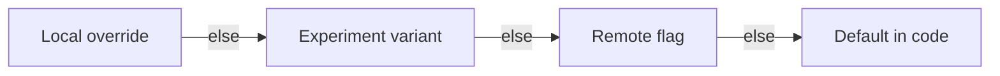

# Switchboard

[](https://github.com/YOUR_USERNAME/Switchboard/actions/workflows/ci.yml)


**Type-safe feature flags for Swift: remote config, local overrides, A/B tests and a debug menu, declared with one macro.**

```swift
@FeatureFlags
struct AppFlags {
    /// Shows the redesigned onboarding flow.
    var newOnboarding: Bool = false

    @FlagKey("max_upload_count")
    var maxUploads: Int = 5

    var checkoutStyle: CheckoutStyle = .classic
}

if store.flags.newOnboarding { … }
```

No string keys at call sites, no `UserDefaults.bool(forKey:)` scattered through the app, and no flags that exist in the dashboard but not in the code.

## Features

| | |
|---|---|
| **Type-safe flags via a macro** | Declare flags as plain properties. `@FeatureFlags` generates the registry, the resolver and the conformance. Misuse is a compile error. |
| **Remote config** | Fetch a JSON document from any URL, or plug in Firebase, LaunchDarkly or your own API with one protocol. |
| **Offline first** | The last config is cached to disk and loaded synchronously at launch, so flags are correct before the first network call. |
| **Activation policies** | Apply new config immediately, or on next launch so flags never flip under a user mid-flow. |
| **A/B/n experiments** | Deterministic, weighted bucketing with FNV-1a. The same user gets the same variant on every launch and device, with no server call. |
| **Local overrides** | Persisted overrides for QA and development, and switched off entirely in release builds with one flag. |
| **Debug menu** | A SwiftUI screen listing every flag with its value, origin (default / remote / A/B / override), search, and editors for each type. |
| **SwiftUI native** | `FlagStore` is `@Observable`, so views update automatically when flags change. |
| **Swift 6** | Strict concurrency throughout. The store is `@MainActor` and flag snapshots are `Sendable` value types. |

## Installation

```swift
dependencies: [
    .package(url: "https://github.com/YOUR_USERNAME/Switchboard.git", from: "1.0.0"),
],
targets: [
    .target(name: "App", dependencies: [
        "Switchboard",
        "SwitchboardUI", // optional: the debug menu
    ]),
]
```

Xcode asks you to trust the macro the first time you build.

## Quick start

### 1. Declare flags

```swift
import Switchboard

enum CheckoutStyle: String, CaseIterable, FlagValue {
    case classic, express, oneTap
}

@FeatureFlags
struct AppFlags {
    /// Shows the redesigned onboarding flow.
    var newOnboarding: Bool = false

    /// Maximum parallel uploads.
    @FlagKey("max_upload_count")
    var maxUploads: Int = 5

    var promoBannerText: String = ""
    var checkoutStyle: CheckoutStyle = .classic
}
```

Supported types are `Bool`, `Int`, `Double`, `String` and any `String`-backed enum that conforms to `FlagValue`. Add `CaseIterable` and the debug menu shows a picker.

<details>
<summary>What the macro generates</summary>

```swift
extension AppFlags: FeatureFlagContainer {}

// Inside AppFlags:
static let definitions: [FlagDefinition] = [
    FlagDefinition(
        key: "newOnboarding",
        description: "Shows the redesigned onboarding flow.",
        defaultValue: (false as Bool).flagRawValue,
        options: FlagDefinition.options(for: Bool.self)
    ),
    // …one per flag
]

init(resolver: FlagResolver) {
    self.newOnboarding = resolver.value(for: "newOnboarding", default: false as Bool)
    self.maxUploads = resolver.value(for: "max_upload_count", default: 5 as Int)
    // …
}

init() {}
```

</details>

### 2. Create the store

```swift
@main
struct MyApp: App {
    @State private var flags = FlagStore(
        AppFlags.self,
        bucketingID: Installation.id, // a stable user or install ID
        source: HTTPRemoteConfigSource(url: URL(string: "https://cdn.example.com/flags.json")!),
        overridesEnabled: Build.isInternal,
        onAssignment: { experiment, variant in
            Analytics.track("experiment_assigned", ["id": experiment.id, "variant": variant.name])
        }
    )

    var body: some Scene {
        WindowGroup {
            RootView()
                .environment(flags)
                .task { try? await flags.refresh(activation: .nextLaunch) }
        }
    }
}
```

### 3. Read flags

```swift
struct RootView: View {
    @Environment(FlagStore<AppFlags>.self) private var store

    var body: some View {
        if store.flags.newOnboarding {
            NewOnboardingView()
        } else {
            OnboardingView()
        }
    }
}
```

`store.flags` is an immutable `AppFlags` value, so you can pass it to view models or across actors safely.

### 4. Add the debug menu

```swift
import SwitchboardUI

SettingsView()
    .featureFlagDebugMenu(store: flags, isPresented: $showFlags)

// or push it inside your own navigation
NavigationLink("Feature flags") { FlagDebugView(store: flags) }
```

Every row shows the key, doc comment, current value and where it came from: `DEFAULT`, `REMOTE`, `A/B · variant` or `OVERRIDE`. Values of the wrong type coming from the server are flagged with a warning.

## Remote config format

```json
{
  "flags": {
    "newOnboarding": true,
    "max_upload_count": 10,
    "promoBannerText": "Free shipping this week"
  },
  "experiments": [
    {
      "id": "checkout-2026-q4",
      "flag": "checkoutStyle",
      "variants": [
        { "name": "control",   "value": "classic", "weight": 50 },
        { "name": "treatment", "value": "express", "weight": 50 }
      ]
    },
    {
      "id": "onboarding-rollout",
      "flag": "newOnboarding",
      "variants": [
        { "name": "on",  "value": true,  "weight": 10 },
        { "name": "off", "value": false, "weight": 90 }
      ]
    }
  ]
}
```

A gradual rollout is just an experiment with weights. Moving from 10% to 50% only adds users, since a user's bucket never changes; it's the variant boundaries that move.

### Using another provider

```swift
// Adapt any existing networking layer or SDK by returning a RemoteConfig.
let source = ClosureRemoteConfigSource {
    let response = try await apiClient.fetchFeatureFlags() // e.g. [String: Bool]
    return RemoteConfig(flags: response.mapValues { .bool($0) })
}
```

## Resolution order



A value with the wrong type at any level is skipped in favour of the declared default, so a typo in the dashboard can't crash the app.

## Design decisions

- **Flags are a value-type snapshot.** The macro turns a struct of stored properties into something the store re-creates whenever inputs change. Reads are plain property access: no string lookups, dictionary hits or locks on the hot path, and the snapshot is `Sendable`.
- **A member macro rather than property wrappers.** A wrapper per flag would need a reference to the store and global state. The macro generates a registry the debug menu can enumerate and keeps the struct a plain value.
- **Compile-time errors over runtime surprises.** `let` flags, missing type annotations and missing defaults are diagnosed by the macro on the exact line.
- **Stable hashing for experiments.** Swift's `Hasher` is randomly seeded on every launch, so `hashValue` would re-bucket users each time. FNV-1a is stable, fast, and trivial to reimplement on a backend so server and client agree.
- **Salted per experiment.** Users bucketed into the treatment of one experiment aren't automatically in the treatment of every other experiment.
- **Activation is explicit.** Changing UI under a user mid-checkout is a real bug class. `.nextLaunch` caches new config and applies it on the next cold start.
- **The cache loads synchronously.** The first frame should use the same flags as the rest of the session; an async load would show defaults and then flicker.
- **Overrides can be switched off.** `overridesEnabled: false` ignores stored overrides and rejects new ones, so a leftover QA setting can never reach production users.

## Testing with flags

```swift
@Test @MainActor func showsNewOnboarding() {
    let store = FlagStore<AppFlags>.inMemory(overrides: ["newOnboarding": .bool(true)])
    #expect(store.flags.newOnboarding)
}
```

Or skip the store entirely and build a value: `AppFlags(resolver: FlagResolver(values: ["newOnboarding": .bool(true)]))`.

## Requirements

- Swift 6.0+ / Xcode 16+
- iOS 17+, macOS 14+, tvOS 17+, watchOS 10+, visionOS 1+

## Roadmap

- [ ] Codable struct flag values (JSON objects)
- [ ] Targeting rules (app version, locale, platform)
- [ ] Exposure tracking on first read
- [ ] Shake-to-open helper for UIKit apps
- [ ] CLI that diffs flags declared in code against the remote config

Contributions are welcome. See [CONTRIBUTING.md](CONTRIBUTING.md).

## License

MIT. See [LICENSE](LICENSE).
